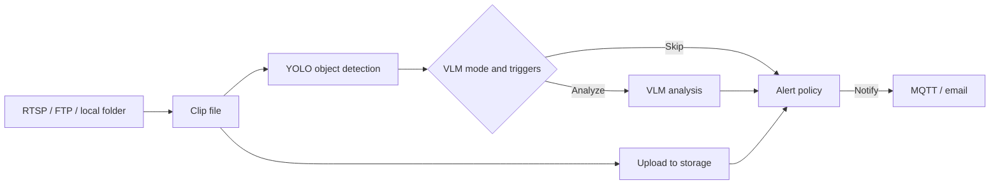

# HomeSec

[](https://pypi.org/project/homesec/)
[](LICENSE)
[](https://www.python.org/)
[](https://peps.python.org/pep-0561/)
[](https://codecov.io/gh/lan17/HomeSec)

**Self-hosted security camera recording, object detection, and AI-assisted alerts.**

HomeSec connects to your cameras over RTSP, accepts uploaded clips over FTP, or watches a local folder. It saves clips to your chosen storage, detects people and animals with YOLO, and can use a vision-language model (VLM) to describe what happened. Alert policies decide which events should trigger a notification.

Use the web UI to review clips, check camera feeds, and monitor system health. Use YAML configuration and plugins to customize how footage is captured, analyzed, stored, and shared.

**You choose where footage goes.** HomeSec runs on your own hardware, but self-hosting does not mean every step stays local. The example configuration uses Dropbox storage and OpenAI analysis; review those settings before starting.

> HomeSec is alpha software. Review the [behavior reference and known limitations](docs/reference.md) before relying on it. Keep access on a trusted network or behind a VPN; enable authentication and appropriate access controls before exposing the service.

## Contents

- [Highlights](#highlights)
- [Quickstart](#quickstart)
- [Configuration](#configuration)
- [Commands](#commands)
- [Pipeline at a glance](#pipeline-at-a-glance)
- [Plugins](#plugins)
- [Observability](#observability)
- [Development](#development)
- [Documentation](#documentation)
- [Contributing](#contributing)
- [License](#license)

## Highlights

- **Flexible camera inputs:** Record motion events from RTSP cameras, receive FTP uploads, or process clips from a watched folder.
- **Selective analysis and alerts:** Run YOLO object detection, optionally add OpenAI-compatible VLM analysis, and tune alert policies per camera.
- **Storage and notifications you control:** Choose local or Dropbox storage and send alerts through MQTT or SendGrid email.
- **A web UI for daily use:** Review clips, view enabled live previews, and check system health.
- **Live preview and talkback:** Use WebRTC or HLS preview, with push-to-talk through supported ONVIF or local TP-Link Tapo backends. Compatibility depends on the camera and firmware.
- **Extensible components:** Add sources, filters, analyzers, storage backends, alert policies, and notifiers without replacing the core pipeline.

## Quickstart

### Docker

The included [Compose file](docker-compose.yml) runs HomeSec and Postgres. Install Docker with Compose, then clone the repository:

```bash
git clone https://github.com/lan17/homesec.git
cd homesec
cp config/example.yaml config/config.yaml
cp .env.example .env
```

Before starting:

1. Edit `config/config.yaml` for your cameras, storage, analyzer, and notifications. The example selects cloud services; change them if you do not want to send footage there.
2. Set the corresponding credentials in `.env`.
3. Comment out the local-development `DB_DSN` line in `.env`. Compose supplies a DSN using its `postgres` service; the mounted `.env` is loaded afterward and would otherwise override it with `localhost`.
4. For durable media, use `/data/recordings` for camera recordings and `/data/storage` for local storage. Compose mounts these paths from the host's `recordings/` and `storage/` directories.

```bash
docker compose up -d
docker compose logs -f homesec
```

Open **http://localhost:8081** on the host to access the web UI. Compose uses `leva/homesec:latest` and mounts the configuration and environment files under `/config`.

Preview is disabled until configured. WebRTC uses UDP ports 8189–8199; set `preview.config.advertised_ip` to the server's client-reachable LAN or VPN IP before enabling it. See the [WebRTC guide](docs/webrtc-preview.md) for reachability and native helper requirements, or the [HLS deployment guide](docs/preview-deployment.md) for HLS scratch storage.

The container attempts database migrations at startup but continues if they fail. Check the logs and schema readiness, especially during upgrades.

### Manual Setup

To run without Compose, you need Python 3.10+, `ffmpeg`, `ffprobe`, and an accessible Postgres database. Build the native helper and UI as described in the [installation prerequisites](docs/webrtc-preview.md#local-development-and-python-installations) and [UI guide](ui/README.md); `pip install` alone does not prepare those assets.

1. **Install the Python package**
   ```bash
   pip install homesec
   ```

2. **Download and edit the configuration**
   ```bash
   curl -o config.yaml https://raw.githubusercontent.com/lan17/homesec/main/config/example.yaml
   curl -o .env https://raw.githubusercontent.com/lan17/homesec/main/.env.example
   ```
   Set your camera and provider settings, then add credentials and `DB_DSN` to `.env`. Use example files from the matching release when installing a specific version.

3. **Apply migrations and validate**
   From a repository checkout matching the installed release, run migrations with the same `DB_DSN` exported in your shell:
   ```bash
   python -m alembic -c alembic.ini upgrade head
   homesec validate --config config.yaml
   ```
   The CLI does not apply migrations when starting. Configuration validation checks settings, not camera, provider, or database connectivity.

4. **Start HomeSec**
   ```bash
   homesec run --config config.yaml
   ```

### Developer Setup
If you are contributing or running from source:

1. **Install tools and build dependencies**
   Follow the [developer prerequisites](docs/webrtc-preview.md#local-development-and-python-installations), then run:
   ```bash
   make dev-setup
   ```
   This installs locked Python/UI dependencies and builds the native helper and UI. It does not start Postgres or HomeSec.

2. **Configure and start infrastructure**
   Copy and edit `config/example.yaml` as `config/config.yaml` and `.env.example` as `.env`. Keep the local-development `DB_DSN` for this host-run setup, then:
   ```bash
   make db  # Starts just Postgres in Docker
   ```

3. **Run**
   ```bash
   make run
   ```
   `make run` applies database migrations before starting; migration failure stops this command. The Docker entrypoint instead warns and continues after a failed migration, so check container logs and schema readiness during upgrades.


## Configuration

Start with [`config/example.yaml`](config/example.yaml). YAML settings are validated against the core and plugin models; fields ending in `*_env` name environment variables rather than containing credentials.

The following is a **configuration fragment**, not a complete runnable file. It adds an RTSP camera with an unlimited reconnect budget and filters for people and dogs:

```yaml
cameras:
  - name: driveway
    source:
      backend: rtsp
      config:
        rtsp_url_env: DRIVEWAY_RTSP_URL
        output_dir: "./recordings"
        stream:
          connect_timeout_s: 2.0
          io_timeout_s: 2.0
        reconnect:
          backoff_s: 5
          max_attempts: 0  # Retry indefinitely

filter:
  backend: yolo
  config:
    classes: ["person", "dog"]
    min_confidence: 0.6
```

Set `DRIVEWAY_RTSP_URL` in your shell or `.env` to the camera's RTSP URL, including credentials if required. Do not commit the value.

To use Dropbox storage and email notifications, merge this fragment into your configuration. Analyzer settings remain separate under `vlm`.

```yaml
storage:
  backend: dropbox
  config:
    token_env: DROPBOX_TOKEN
    root: "/SecurityCam"

notifiers:
  - backend: sendgrid_email
    config:
      api_key_env: SENDGRID_API_KEY
      from_email: "alerts@example.com"
      to_emails: ["me@example.com"]
```

Set `DROPBOX_TOKEN` and `SENDGRID_API_KEY` in your environment or `.env`, never in YAML or source control.

The [core models](src/homesec/models/config.py) and each plugin's configuration model define supported settings and defaults.

### Configuration notes

- **Optional notifications:** Without enabled notifiers, alert decisions are still evaluated and recorded, but no external notifications are sent.
- **Supported YOLO classes:** `person`, `bird`, `cat`, `dog`, `horse`, `sheep`, `cow`, `elephant`, `bear`, `zebra`, and `giraffe`. Other names are ignored; an entirely unsupported list fails detection.
- **Preview and recording:** Preview yields to recording by default. Concurrent preview is best-effort and may require an extra camera session. Keep HLS scratch storage separate from recordings and durable storage.
- **Push-to-talk:** RTSP cameras are auto-probed, with ONVIF tried before the local Tapo backend. Disable probing per camera with `cameras[].talk.mode: disabled`. Camera and firmware compatibility, including physical Tapo C120 validation, is not guaranteed; see the [push-to-talk guide](docs/push-to-talk.md).

## Commands

Run the pipeline:
```bash
homesec run --config config.yaml
```

Validate configuration:
```bash
homesec validate --config config.yaml
```

Recheck old clips for cleanup:
```bash
homesec cleanup --config config.yaml --older_than_days 7
```

Cleanup defaults to a dry run. Inspect its output before explicitly applying with `--dry_run=False`. It rechecks eligible clips using the YOLO-shaped cleanup configuration, deletes storage objects before marking records deleted, and can also remove a separate local recording. It is distinct from automatic retention and API deletion; review the [cleanup limitations](docs/reference.md#storage-retention).

Use `homesec --help` or `homesec <command> --help` for more options.

## Pipeline at a glance

Each incoming clip is uploaded to storage and checked by the object filter in parallel. VLM analysis runs only when its configured mode and trigger classes call for it. The alert policy evaluates the result and sends notifications through the enabled backends.



- **Partial failures:** Upload failures do not block alerts; filter failures stop VLM calls.
- **Database outages:** Recording and uploads can continue when Postgres is unavailable. Reconnect and stage retries still have explicit limits.
- **Persistence limits:** Postgres stores clip snapshots and best-effort lifecycle events in separate writes. A stored snapshot does not guarantee complete event history or recovery after a restart. See the [behavior reference](docs/reference.md).

## Plugins

Sources, filters, storage, analyzers, alert policies, and notifiers implement [shared interfaces](src/homesec/interfaces.py). Swap a built-in backend through configuration, or implement a plugin to add a new one.

### Built-in plugins

| Type | Plugins |
|------|---------|
| Sources | [`rtsp`](src/homesec/sources/rtsp/core.py), [`ftp`](src/homesec/sources/ftp.py), [`local_folder`](src/homesec/sources/local_folder.py) |
| Filters | [`yolo`](src/homesec/plugins/filters/yolo.py) |
| Storage | [`dropbox`](src/homesec/plugins/storage/dropbox.py), [`local`](src/homesec/plugins/storage/local.py) |
| VLM analyzers | [`openai`](src/homesec/plugins/analyzers/openai.py) |
| Notifiers | [`mqtt`](src/homesec/plugins/notifiers/mqtt.py), [`sendgrid_email`](src/homesec/plugins/notifiers/sendgrid_email.py) |
| Alert policies | [`default`](src/homesec/plugins/alert_policies/default.py), [`noop`](src/homesec/plugins/alert_policies/noop.py) |

Built-ins register through decorators when imported. External packages use the `homesec.plugins` entry-point group. See the [plugin development guide](PLUGIN_DEVELOPMENT.md) for interfaces, registration, and complete examples.

## Observability

- **Health:** `GET /health` and `GET /api/v1/health` are public endpoints on the configured server port. Database unavailability reports `degraded` with HTTP 200; a stopped or stale runtime reports HTTP 503. Bootstrap mode reports `setup_required` with HTTP 200.
- **Telemetry:** `DB_DSN` enables a separate Postgres log handler, with ordinary log verbosity controlled by `DB_LOG_LEVEL`. Telemetry is best-effort: queue limits and failed writes can lose records, and logs do not replace clip state or history.
- **Safe troubleshooting:** Logs are not a universal secret scrubber. Keep credentials, tokens, raw media, and full DSNs out of logs and support captures. See the [logging guidance](AGENTS.md#logging-guidance).

## Development

Follow [Developer Setup](#developer-setup) to install the toolchain and run from source. Python dependencies are managed with [uv](https://docs.astral.sh/uv/); the UI uses pnpm and the native media helper uses Rust.

| Command | Purpose |
| --- | --- |
| `make dev-setup` | Install locked dependencies and build the UI and native helper |
| `make db` | Start local Postgres |
| `make run` | Apply migrations and start HomeSec |
| `make test` | Run Python tests with coverage |
| `make typecheck` | Run strict Python type checking |
| `make check` | Run the full lockfile, Rust, Python, and UI gate |

## Documentation

Use the [documentation index](docs/README.md) for all maintained guides.

| Guide | Covers |
| --- | --- |
| [Behavior reference](docs/reference.md) | Current capabilities, specifications, and known limitations |
| [WebRTC and native media](docs/webrtc-preview.md) | Build prerequisites, preview networking, codecs, and troubleshooting |
| [HLS deployment](docs/preview-deployment.md) | Scratch storage, camera sessions, and recording policy |
| [Push-to-talk](docs/push-to-talk.md) | Camera backends, microphone requirements, and compatibility |
| [Postgres backups](docs/postgres-backups.md) | Backup configuration, retention, and restore procedures |
| [Architecture](DESIGN.md) | Component boundaries and runtime lifecycle |
| [Plugin development](PLUGIN_DEVELOPMENT.md) | Custom backends and registration |
| [Testing](TESTING.md) and [CI](CI.md) | Behavioral tests, database isolation, and validation |
| [UI development](ui/README.md) | Frontend setup and generated API models |

## Contributing

Read the [development guidelines](AGENTS.md), create a branch, and keep your change focused. Use the existing plugin patterns and include Given/When/Then comments in tests. Run `make check` before committing or opening a pull request, and explain the change and validation in the PR description.

For bugs or feature requests, [open an issue](https://github.com/lan17/homesec/issues). Include what you expected, what happened, steps to reproduce, and your OS, Python version, and HomeSec version. Remove secrets from logs and configuration before sharing them.

## License

Licensed under [Apache 2.0](LICENSE).
