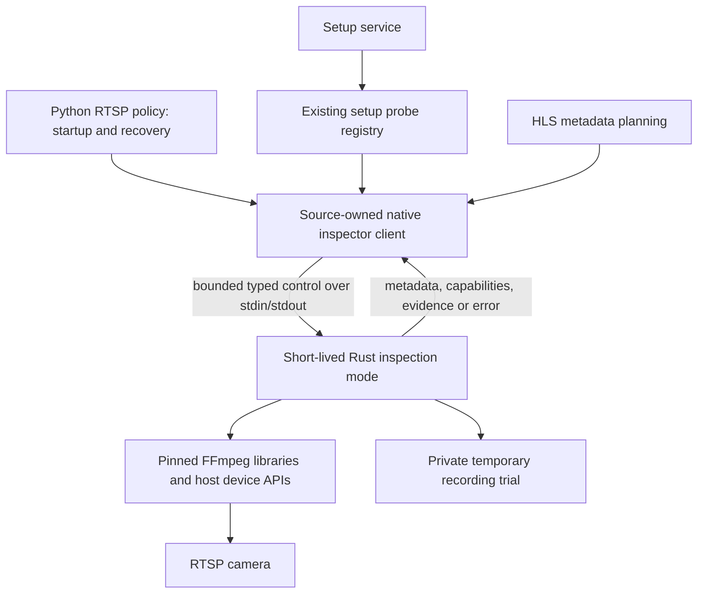

# Design

## Context

See [proposal.md](proposal.md) for motivation and confirmed scope. These decisions were approved for implementation in follow-up commits on the existing PR. Task checkboxes and scenario evidence track implementation and validation separately.

The source audit found these existing seams:

| Area | Current implementation | Consequence for this change |
| --- | --- | --- |
| Discovery | `sources/rtsp/discovery.py` exposes typed probe models and shells out to `ffprobe` | Keep the models and ordering contract; replace the adapter |
| Startup | `preflight.py` owns selection, recording trials, timestamp retries, and independent overlap checks | Keep Python policy; replace execution primitives |
| Recovery / HLS | `core.py::_probe_stream_info` duplicates probing; `live_publisher.py` uses discovery for codec planning | Migrate both, including lazy probes after startup |
| Hardware | `hardware.py` enumerates host CLI features and trial-decodes five frames; a timeout currently counts as success | Inspect linked features/device availability and require actual decode evidence |
| Setup | Registered `setup_probe.py` calls preflight through `wait_for(to_thread(...))`; `services/setup.py` checks `which('ffmpeg')` | Reuse registration, retain response fields, and give cancellation an actual work owner |
| Native transport | `helper_client.py` already bounds typed control messages and supervises a process group | Reuse it for an inspection mode in the existing executable |
| Native input | `camera_input.rs` owns libavformat input/deadline/quiet-log behavior, but gates metadata on H.264 recording eligibility and an IDR | Reuse lower-level input primitives, not the gated camera worker as a generic inspector |
| Build | `native/webrtc/build_native.py` pins private static libraries, checks archives, caches outside the repo, and builds in parallel | Extend this recipe and its tests; do not discover system libav libraries |

The current build enables H.264 decoding, selected audio decoders, x264/Opus encoding, and MP4 muxing. It does not enable HEVC decoding/parsing, AAC encoding, or hardware backends. The user confirmed that native validation coverage must expand to preserve existing camera support. A CPU/H.264-only replacement is insufficient.

The maintained capture and setup specs own the deltas. Existing preview/talk behavior remains a compatibility constraint. `docs/reference.md` correctly notes that startup ignores custom `stream.ffmpeg_flags`; this change must not turn that limitation into a claim that arbitrary custom flags have been validated.

## Goals / Non-Goals

**Goals:** one source-owned native inspection boundary; unchanged Python selection/negotiation policy; explicit distinction between observed metadata, available capabilities, and operation evidence; bounded ownership across synchronous startup and asynchronous setup callers.

**Non-Goals:** no new daemon, public configuration, HTTP endpoint, general CLI-argument interpreter, or PyO3 extension. No change to YOLO inference, pipeline/repository ownership, camera lifecycle policy, preview transport, or shared-session accounting. Tickets 190–193 and 195–196 keep their separate deliveries.

## Decisions

### 1. Reuse the camera helper as a short-lived inspector

Add a mutually exclusive inspection mode to `homesec-webrtc`. Python owns a helper for one bounded inspection group, then stops and reaps it. A group can perform sequential profile trials or the existing concurrent role checks; it is not a persistent camera service. Reuse `HelperClient` framing, typed request/reply validation, bounded writes, readiness exchange, and process-group cleanup.

A dedicated daemon would add discovery, restart, scheduling, and deployment concepts without a requirement for them. Calling libav through a new in-process Python binding would put uninterruptible resolver/native work inside the control process and introduce another packaging boundary. Invoking a pinned FFmpeg executable would still violate the agreed no-CLI inspection requirement.

### 2. Keep a small semantic control contract

Private Rust serde and Python Pydantic models describe the operations below. Extend existing typed transport models rather than passing dictionaries across the boundary. Reuse the current 128,000-byte message bound; retain bounded URL, stream-count, packet, pending-request, and duration limits. Existing topology needs at most three concurrent roles per check. No raw frames, audio, codec extradata, or unbounded library text travel in control replies.

| Operation | Semantic inputs | Evidence returned |
| --- | --- | --- |
| Capabilities | No camera for build inspection; selected backend/device for device inspection | Control compatibility, linked library/build identity, compiled components, device availability; never a blanket working-camera claim |
| Metadata | URL and remaining connect/I/O/operation budgets | First video/audio metadata, dimensions, numeric/raw rational frame rate, per-input outcome |
| Decode validation | URL, selected software/hardware backend/device, bounded sample budget | Frames actually decoded, actual backend used, or a typed refusal/failure |
| Recording trial | URL, MP4 video-copy/audio-copy-or-AAC-or-none, stream-or-wallclock timestamp mode, owned temporary target, bounded duration | Successful finalization, media/output evidence, bounded timing stability signals, or failure |
| Overlap validation | Existing role list and overlap/sample budgets | Per-role readiness/completion and supported/session-limit/unclassified evidence |

URLs and credentials go through the private pipe, never command-line arguments. Suppress raw libav logs; derive bounded stable reasons such as authentication/connection failure, timeout, no usable video, local capability unavailable, profile validation failure, and helper/protocol failure. Keep existing public setup fields and source refusal reasons; this does not introduce a new public error schema. Unknown native errors map to a redacted local failure, not raw stderr.

The ready/capability exchange rejects a helper without the required inspection contract. Reuse the RTSP source's configured/default helper selection: the existing global `PreviewConfig` selects a WebRTC helper override even when preview is disabled; HLS/no override uses `homesec-webrtc`. Centralize that small source-owned selection function for runtime and inspector callers. No new helper-path setting is needed. Setup context propagation is defined in decision 7 so its tests cannot accidentally inspect a different executable.

### 3. Separate discovery from recording eligibility

Extract only reusable input opening, bounded probing, deadlines, and close handling from `camera_input.rs`. The inspector reads libav stream descriptions independently of `StreamConfig::copy`, H.264/AAC eligibility, or the first-IDR gate. It may consume bounded packets to discover required dimensions, but metadata success must not depend on beginning a recording. A discoverable codec unsupported by a specific decoder/recorder still produces truthful metadata.

Retain `ProbeStreamInfo` / `CameraProbeResult` semantics: ordered URL deduplication, first video and optional first audio, missing values remaining absent, and per-candidate failures rather than discarding successful candidates. Keep Python's deterministic low/high stream selection. Route recovery and HLS metadata through the same adapter instead of keeping a second parser in `core.py`.

### 4. Preserve profile policy and expand native validation coverage

Python keeps `build_recording_profile_candidates`, profile IDs, ordering, and timestamp retry selection. Translate the existing generated profile into explicit private semantic fields; do not make Rust interpret arbitrary FFmpeg arguments. Keep the compatibility recorder's existing argument representation until ticket 195 replaces execution.

Reuse native decode/mux primitives where they fit, extending the library-backed validation path where the current H.264/AAC-LC recorder is too narrow. Validation support must not automatically broaden shared-runtime eligibility. Trial output is temporary, finalized and nonempty, then removed; it never becomes a production clip or repository event. Include media packet evidence so an empty container header cannot pass. Preserve timestamp retry thresholds and weighting from `RecordingValidationSignals`; populate them from bounded native packet/mux/codec diagnostics, without persisting or returning raw library messages. Preserve outcomes for baseline, improved wallclock, failed retry, and no improvement.

Compatibility coverage required before complete cutover:

| Existing behavior | Native validation obligation | Execution boundary |
| --- | --- | --- |
| H.264 and HEVC camera video | Metadata; software motion/session decode; MP4 video-copy trials | Shared native eligibility remains unchanged; other execution stays compatible until 195 |
| MP4 copy-audio allowlist | Exercise AAC, AC3, ALAC, EAC3, MP2, and MP3 copy profiles; preserve packet timing and audio presence | Do not reduce the allowlist to AAC-LC |
| AAC conversion fallback | Enable the pinned AAC encoder plus required input decoders/resampling; include G.711 and Opus conversion fixtures | Keep copy → AAC → silent policy; build omissions are not candidate failures |
| No-audio input / genuine audio trial failure | Exercise the existing silent candidate and genuine conversion-failure fallback | No silent fallback merely because the bundled build omitted a required component |
| Timestamp instability | Native diagnostic cases matching existing retry thresholds and successful/lower-score selection | Native validation is evidence for this operation, not proof of another executor |
| VAAPI, CUDA/NVENC, QSV, VideoToolbox | Preserve applicable Linux/macOS detection priority; report compiled support, usable device, actual decode, and requested encoder availability separately | Preserve existing execution fallbacks; do not claim a host CLI backend was tested |
| Other currently supported camera codecs | Metadata inspection stays codec-independent; add required validation components and parity fixtures before cutting over that supported combination | No blanket claim of universal FFmpeg codec support |
| Custom stream flags | Retain existing startup limitation and metadata behavior | Custom execution translation/coverage belongs to 195 |

Extend the pinned static FFmpeg build recipe with needed parsers, codecs, filters, and platform adapters. Preserve checksummed source downloads, private temporary build/cache directories, parallel compilation, cache fingerprint invalidation, and static libav linkage. OS GPU drivers/frameworks remain platform dependencies; they are distinct from linking arbitrary system FFmpeg. Pin any newly downloaded build dependency using the existing mechanism. The baseline software build must remain usable without a GPU; a host without a device reports unavailability rather than breaking startup.

For a supported hardware target, missing build support is a delivery gap, not evidence that the camera or host lacks hardware. Hardware enumeration alone does not pass decode. Deliberately retire the legacy timeout-as-success behavior: a trial must decode the bounded sample through the requested backend, with no hidden software fallback inside a claimed hardware success. Keep software fallback as a separate explicit result/path.

While compatible CLI execution remains, native evidence does not certify that CLI. HLS already retries its software plan, but the current compatible motion decoder does not. Add the minimum executor-local protection at this handoff: if selected hardware is rejected or fails before usable frames within the existing input startup deadline, stop that input, mark hardware failed through the existing source hardware-failure state, and retry software at most once for that input attempt. Remember that failure for the camera worker lifetime; subsequent input attempts use software until the worker is recreated. A failed software attempt returns to existing retry/exhaustion policy, with no hardware/software cycle. Cover native-positive/legacy-negative and both-paths-fail cases. This is compatibility protection required by the probe cutover, not replacement of motion execution in ticket 195.

### 5. Retain preflight topology and classification

Replace CLI role execution, not Python's role policy. Preserve separate motion/recording and optional preview or metadata opens, including equal URLs. Require the existing overlap plus bounded successful role completion and media evidence. Classify only explicit camera session-limit evidence as capacity denial; generic auth/network/decode/timeouts remain failed/unclassified as today. Keep the source's existing single-stream fallback and preview downgrade/refusal behavior.

Ticket 192 will replace this conservative topology with shared-aware admission. Ticket 194 must not infer one session from equal URLs or install a second admission manager. Inspection may not preempt an existing recording: use the existing source/preview guard, close optional probe inputs on denial, and never stop the recorder to obtain a successful probe. Probe deadlines bound any temporary competition for camera capacity.

### 6. Give cancellation a concrete owner and one overall deadline

Each group owns its helper, camera inputs, and private trial directory. Maintain a monotonic overall deadline that includes helper startup, all attempted candidates/profiles, overlap sampling, and cleanup. Each operation receives the remaining budget capped by its connect/I/O limits; retries do not reset the overall deadline. Reuse existing caller timeout settings, rather than add public knobs.

Startup's existing `command_timeout_s=8` is a per-operation cap, not an eight-second budget for the whole preflight. Derive a finite startup group budget from the maximum permitted operations for its deduplicated candidate list: metadata attempts, profile trials and possible wallclock retry, dual/single-stream overlap attempts, requested preview checks, plus bounded helper startup/cleanup. Use each operation's existing cap (and role-count-aware overlap bound); do not compress multiple valid trials into one command's budget. Standalone recovery/metadata retains its caller's operation cap. Setup separately supplies its existing total 10/11-second outer budgets, so its remaining deadline can end a longer plan. Test a multi-step startup that exceeds one operation cap in total but stays within the derived group budget, as well as a single stalled step and an exhausted setup deadline.

On success or failure, close inputs, stop/reap the helper, then remove trial files. On cancellation or expiry, first stop new operations, request cooperative close with bounded RTSP teardown, then terminate/kill and reap the owned process group if necessary. The parent deadline also covers DNS/native work that outlives libav interrupt callbacks. A helper exit or malformed reply takes the same cleanup path. Remote camera-side lease expiry cannot be guaranteed after a lost connection; local work and ownership must be closed or explicitly reported as cleanup failure.

`HelperClient.request` timing out does not itself stop native work. The inspector owner must always call bounded stop/cleanup. Setup's existing `wait_for(to_thread(...))` is insufficient: pass cancellation/deadline ownership into the source adapter and wait for its cleanup, instead of abandoning the thread. Reserve cleanup time inside the existing Test Connection and registry budgets (currently 10 and 11 seconds). If the default `HelperClient.stop` grace periods do not fit, add a private remaining-budget argument with unchanged defaults for existing media callers. No cancelled thread may continue opening inputs after its response/cleanup is declared complete. Surface failure to stop/reap; never label an uncompleted cleanup successful.

### 7. Keep setup generic and readiness narrowly truthful

Retain the `ffmpeg` check key and response shape for compatibility, with a message describing native inspection readiness and linked identity. A successful bounded capability exchange and required baseline components establish this check; file existence or host CLI discovery do not. This check is camera-free, opens no RTSP session, and still obeys setup's check deadline.

The generic setup service must not import RTSP protocol/helper modules. Extend the existing setup-probe registration with an optional backend readiness callable and retrieve the RTSP implementation through that registry; do not create a parallel registry or invoke full Test Connection without camera configuration. Pass a small typed setup-probe context containing the existing global `PreviewConfig` to the RTSP readiness and connection-test callbacks through that registration boundary. Resolve context from active configuration when available, otherwise existing saved configuration in bootstrap/no-active-runtime mode, otherwise the existing defaults. The source callback interprets it and applies the same source-owned helper selection function as runtime; the generic service does not read WebRTC-specific helper fields. Preserve existing non-RTSP callbacks and aggregation; context-aware RTSP registration must not force unrelated probes to consume new arguments.

Verify default bootstrap, custom helper with enabled or disabled WebRTC preview, HLS preview, and active-versus-saved configuration divergence. Readiness remains camera-free. Test Connection adds this internal context to source validation without adding a public request field or saving it as camera configuration. Both calls must fail against an invalid configured override rather than silently probing a different default executable.

Document that the check establishes inspection readiness only. During staged migration the compatible recorder, WebRTC conversion, or HLS publisher can still need a CLI executable. Keep those execution prerequisites in operator/reference docs until 195/196; passing this check does not establish their success. Preserve Test Connection success/failure details and no-save/no-activation behavior.

## Risks / Trade-offs

- **Larger native build and platform surface** → enable the components required by the compatibility matrix, preserve deterministic cache/build isolation, and test Linux/macOS recipes. Do not declare hardware parity from a software CI run.
- **Validator and remaining executor differ** → label the scope of evidence, add the bounded compatible-motion software retry, retain existing HLS fallback, and require separate execution/device evidence in 195; do not remove compatibility code here.
- **Native timing diagnostics drift from CLI warnings** → fixture packet timing failures and compare profile-selection outcomes; a zero diagnostic count caused by missing instrumentation cannot pass parity.
- **Setup deadline expires during threaded native work** → one owner, cancellation propagation, cleanup reservation, and stalled resolver/helper tests; no detached work after reported cleanup.
- **Probe sessions compete with recording** → preserve recording priority and current conservative topology; bound inspection lifetime and defer topology changes to 192.
- **Transient failures look like unsupported cameras** → stable local capability versus connectivity classifications, preserved background retries, and partial metadata tests.
- **Privacy leaks through library diagnostics** → quiet/redacted native diagnostics, bounded typed replies, secret-bearing fixture tests, and URLs only over stdin.

## Migration Plan

1. Add native inspection primitives, build coverage, and actual protocol/helper tests behind the existing source boundary. Existing callers remain unchanged until their replacement is ready; these intermediate commits are not ticket completion.
2. Replace discovery, recovery/HLS metadata, profile trials, overlap checks, and hardware inspection together with source integration. Preserve policy tests while replacing command-array mocks with meaningful boundary coverage. Do not keep an automatic CLI probe fallback.
3. Switch setup readiness and Test Connection with real cancellation ownership. Update affected reference/evidence and operator docs with the explicit staged execution boundary.
4. Gate cutover on the compatibility matrix, absent/old CLI cases, bounded failure/cancellation, and required repository checks. Keep device-dependent acceptance pending until tested; a software-only run does not close all of 194.
5. Roll out through the usual version/runtime restart procedure only after validation. This planning PR performs no production rollout. If a regression needs rollback, use the prior known working release and its documented CLI prerequisites; do not add hidden runtime probe fallback or new configuration.
6. Supply the semantic operations to ticket 192. Leave recording/preview/HLS execution replacement to 195 and final dependency retirement/packaging verification to 196. Sync/archive these deltas only after implementation and evidence review, not merely because this planning PR merges.

## Validation Approach

Use existing fake RTSP support under `native/webrtc/tests/support` with the real helper/library boundary for metadata, authentication, failed/empty/unstable media, overlap, stalls, cancellation, teardown, and cleanup. Extend Python source/setup tests at the helper/process boundary, retaining real policy/model code. Test no tools on `PATH` and incompatible executables first on `PATH`; allow fixture/oracle tooling outside application runtime under test.

Maintain a scenario-to-evidence table in the implementation PR and affected reference/evidence docs. Distinguish structural OpenSpec validation, mocked policy checks, actual helper/protocol coverage, local IPyCam integration, and hardware/physical-camera evidence. IPyCam verifies local H.264 flow, not every audio/hardware combination. The task plan names the affected suites and release gates.
