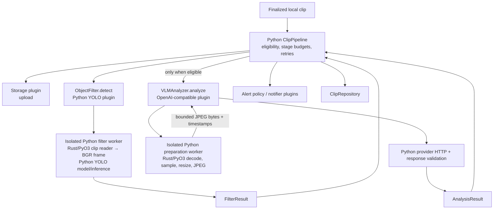

# Design

## Context

See [proposal.md](proposal.md) for motivation and [the analysis delta](specs/analysis-alerts/spec.md) for the proposed contracts. This is a plan, not evidence that native preparation has shipped.

Current boundaries and behavior were checked against `origin/main`:

| Area | Current implementation | Consequence |
| --- | --- | --- |
| Pipeline | `pipeline/core.py` starts upload/filter independently, then eligible VLM work after filtering; stage semaphores and retries live here | Preserve stage inputs/results, eligibility and policy; do not move media preparation into the pipeline |
| YOLO | `plugins/filters/yolo.py` owns a process pool and per-process model cache; OpenCV supplies original-size BGR samples | Replace its clip reader, keeping Ultralytics/PyTorch and model-specific work in that same Python worker |
| VLM | `plugins/analyzers/openai.py` uses `asyncio.to_thread`, OpenCV and Pillow before an async HTTP request | Preparation isolation is new work; provider HTTP, base64/message construction and structured-response validation stay in Python |
| Plugins | Category loaders use the unified registry and Pydantic config; registry `runtime_context` is merged into config before validation | Do not inject executors or backend-only settings into configuration or create a second registry |
| Native build | `native/webrtc/build_native.py` pins FFmpeg 8.1.3, verifies archives, uses private temporary caches/locks and parallel builds | Reuse source identity and bootstrap mechanics; the existing camera build's codec set and dependencies are insufficient for general clip preparation |
| Distribution | Hatchling currently builds a Python package; Docker and release workflows assume no extension build | A Maturin mixed package requires complete wheel/source/editable/CI/Docker integration, not a manual second installation step |

The maintained `analysis-alerts` spec and `docs/reference.md` explicitly describe empty/partial YOLO results, distinct-class `min_hits`, frame-stride `sample_fps`, and retry limits that bound attempts rather than elapsed time. This change preserves those limits.

Leonidas confirmed on 2026-10-18: cooperative cancellation and pool recovery; equivalent image pixels/encoding with parity checks; one HomeSec package using Maturin; and tight stage interfaces with plugin-owned implementations. Runtime supplies only execution capacity; the analyzer does not read global configuration.

## Goals / Non-Goals

**Goals:** retain the existing `ObjectFilter.detect` / `VLMAnalyzer.analyze` stage contracts, keep native handles inside analysis workers, and make the installed media source identity independent of system FFmpeg and the OpenCV wheel.

**Non-goals:** native object inference, an analysis daemon, cross-stage frame caches, raw-frame IPC to the pipeline, camera ingestion/session changes, durable handoff, generic retry deadlines, changing deletion policy, or retiring CLI paths outside these two consumers. Python OpenCV can remain a transitive YOLO dependency; HomeSec must no longer use its independent video decoder for these clip readers.

## Decisions

### 1. Native preparation is a plugin implementation detail

No pipeline branch knows whether a plugin uses Rust, Python or a different provider. Keep existing registry discovery, validated plugin configuration and category loaders. Keep the native module private to media/preparation adapters used by the concrete plugins; core/API/UI do not import it.

For pool sizing, add one narrow **optional** worker-capacity interface in `interfaces.py`, with a typed `configure_workers(limit: int)` lifecycle method called before first use. Extend the analyzer category loader with an optional keyword capacity; after ordinary registry construction, call the method only for plugins implementing that capability. Runtime assembly passes `config.concurrency.vlm_workers`. Existing analyzer plugins without the capability continue unchanged; no new required factory signature, persisted config field or global executor is introduced. Document and test this opt-in interface in `PLUGIN_DEVELOPMENT.md`.

This small seam keeps the global setting owned by runtime assembly while the concrete plugin owns its pool. A single preparation worker would serialize previously concurrent preparation. Injecting an executor into Pydantic config or a global variable hides ownership; moving preparation into `ClipPipeline` breaks the stage boundary. Changing every analyzer's `analyze` signature is unnecessary.

### 2. A private native reader owns media; Python owns model/provider policy

Add a private preparation crate, separate from the WebRTC binary, and a thin typed Python adapter. Do not link the extension to the binary's Retina/WebRTC stack or its motion-specific H.264-to-grayscale decoder.

The minimal native boundary is a local-file reader with metadata, indexed sample reading, and image preparation. It supports one-sample-at-a-time calls so Python workers can check cancellation between samples. Keep scheduling calculations source-compatible; moving them into Rust does not authorize a new sampling algorithm.

| Boundary | Request | Returned ownership |
| --- | --- | --- |
| Parent → YOLO worker | Local path, existing effective detector settings, job cancellation endpoint | Existing `FilterResult` only; no video frames leave the worker |
| Rust → Python inside YOLO worker | Requested sample index | Owned BGR byte buffer, dimensions and timestamp metadata; adapter validates shape and makes the writable NumPy image expected by YOLO |
| Parent → VLM preparation worker | Local path and existing preprocessing values, cancellation endpoint | A bounded typed sequence of JPEG bytes and timestamp metadata |
| Rust → Python inside VLM worker | Requested sample index, effective size/quality | Owned JPEG bytes and metadata for that sample |
| VLM plugin → provider | Existing timestamped message contract | Base64 conversion occurs only when constructing the existing provider JSON request |

Use typed adapter records/Pydantic models for process-boundary payloads, `.pyi` typing for the extension, checked buffer sizes/strides and explicit close/context-manager behavior. Return owned bytes initially; avoid unsafe borrowed Rust memory, a Rust NumPy ABI dependency or shared-memory frame lifetime protocols. A copy is acceptable until measurements justify a different ownership mechanism. Release the GIL during native decoding/conversion and reacquire it only to construct returned Python objects.

Media memory is proportional to one current decoded/converted sample plus codec buffers; VLM additionally retains at most the requested compressed samples and the existing request representation. Do not decode/store a whole clip or cache raw frames between stages. Cancellation and failed preparation release handles and buffers. Only regular local files are accepted; disable network protocols and external media references in the preparation profile so uploaded media cannot cause URL fetching. Never log/persist media bytes or unredacted source secrets.

### 3. Preserve the actual consumer semantics

**Frame metadata and seeking.** OpenCV's current FFmpeg backend uses reported `nb_frames`, falling back to a rounded duration × FPS estimate. Its indexed seek is timestamp/FPS based; an exact sequential frame count or ordinal reader can select different VFR images. Preserve the reported-count/fallback and indexed-seek compatibility contract, including first-video-stream selection, stream-start-relative PTS/DTS timestamps, missing timestamps and default autorotation. Keep Python's existing timestamp formatter for identical hundredth-second labels. Optimize sequential reads only when fixture comparisons prove identical selected images and labels.

The compatibility source is [OpenCV 4.12 FFmpeg capture](https://github.com/opencv/opencv/blob/4.12.0/modules/videoio/src/cap_ffmpeg_impl.hpp) and its [rotation behavior](https://github.com/opencv/opencv/blob/4.12.0/modules/videoio/src/cap_interface.hpp). Store expected outputs in baseline fixtures; do not load OpenCV at runtime as a fallback or copy its implementation wholesale.

**YOLO.** Sample indices remain `0, sample_fps, 2 * sample_fps, ...` below reported count. Supply the original oriented dimensions and BGR channel order. Preserve model cache/device selection, supported-class filtering, confidence, minimum box-height equality, distinct-class `min_hits`, class order, maximum confidence and sampled-frame count. Stop reading on the first failed selected read; retain existing zero/partial results. Once early exit occurs, close the reader without requesting remaining samples. A corrupt later portion must not fail an already completed early-exit detection. Ordinary read failure remains distinct from a crashed worker or programmer exception.

**VLM.** Keep all indices when `N <= M`, otherwise `floor(i * N / M)` for `i = 0..M-1`. Skip a failed selected read; no surviving samples fail analysis before provider HTTP. Preserve no-upscale resizing, integer truncation of the shorter dimension and timestamp labels. `max_frames`, `max_size` and `quality` currently have unconstrained integer types: characterize accepted edge cases and retain their outcomes; do not silently introduce new config rejection, caps or retry policy in this ticket.

Use the existing FFmpeg software-scaling library for resizing and an exact-pinned small JPEG encoder rather than adding an image framework or OpenCV videoio. A candidate is `jpeg-encoder = "=0.7.1"`, explicitly configured for baseline sequential JPEG and 4:2:0 sampling instead of its quality-dependent subsampling default. Its documented quality range differs from Pillow; the adapter must preserve existing effective quality behavior, including zero/default/out-of-range handling, with tests before replacing Pillow. Source: [encoder documentation](https://docs.rs/jpeg-encoder/0.7.1/jpeg_encoder/struct.Encoder.html). If the candidate cannot meet the compatibility gates, adjust the encoder implementation within this boundary rather than changing the public settings silently.

Equivalent images means small decoding/resampling/compression differences in the **same camera sample**; it does not permit different timestamps, selected content, aspect ratio or YOLO decision semantics. See the acceptance gates below.

### 4. Reuse process pools with explicit job ownership

Keep YOLO's reusable per-process model cache and configured `max_workers`. Add a lazy OpenAI preparation pool sized by the runtime-supplied capacity. Use spawn contexts and module-level picklable worker entry points; avoid forking initialized native/GPU state. Instantiate neither pool's worker processes until work requires them. VLM workers perform preparation only, with no provider credentials, HTTP clients or model loading in their job payload.

A private job helper can share real duplicated admission/cancellation/cleanup code between these two owners, but must not become a new stage scheduler or generic service. Each pool has an admission bound no larger than its capacity, acquired before submission and released when the underlying concurrent future actually settles. Awaiting coroutines use a shielded asyncio wrapper while the owner retains the original future. Cancelling a caller must not release a slot while its worker is still running or accumulate replacement work in an executor queue.

Use a small per-job one-way multiprocessing pipe: retain its parent endpoints through actual job completion, pass the receiver to the worker, and poll between samples and after model inference. Signal only that job on caller cancellation. A worker closes its reader and local pipe endpoint in `finally`; the owner closes retained endpoints after settlement. A queued future is cancelled when possible; if dispatch has already occurred, the worker observes the signal before further preparation. Running model inference may finish; discard its cancelled result before requesting another sample or starting provider work. Do not add monitor threads or a shared-memory cancellation protocol merely to provide between-sample cancellation.

On abrupt worker death, surface the failed attempt as a failure, not an empty detection. Stop admission to the broken generation, cancel/signal its jobs and retire that executor outside the event loop. Serialize replacement and wait for old-generation retirement before admitting work to a fresh pool; repeated failures must not accumulate generations. The existing Python stage retry runner decides whether another attempt occurs. No hidden native retries, provider replay or repository writes are added.

Plugin-owned shutdown stops admission, signals active jobs and cancels pending ones, then asynchronously drains within the existing component wait budget. Pool joins must run outside the event loop. If a native/model call remains stuck while its owner is alive, retain cleanup ownership and report unfinished work; Python 3.10's public executor API does not force-kill running work. Do not claim bounded process termination or access executor private process tables. References: [Python connection objects](https://docs.python.org/3.10/library/multiprocessing.html#connection-objects), [executor shutdown](https://docs.python.org/3.10/library/concurrent.futures.html#concurrent.futures.Executor.shutdown).

Whole-runtime supervision is a separate existing policy: `subprocess_controller.py` sends SIGTERM to the runtime process group, which can terminate analysis children before cooperative cleanup; later group SIGKILL is conditional on the runtime leader remaining alive. Abrupt parent exit does not currently prove remaining-descendant cleanup. Preserve that policy in this focused change, explicitly document the limit, and verify normal group-stop behavior without calling it cooperative completion. Do not ignore SIGTERM in analysis workers: the standard executor also uses it to retire a broken pool, so ignoring it can prevent recovery. Stronger graceful group shutdown and parent-death containment require a separate supervisor change; they are not promised here.

### 5. One mixed Python/Rust distribution with a shared verified bootstrap

Use Maturin for the existing `src/homesec` mixed layout and a private module such as `homesec._native_media`. Pin compatible PyO3/Maturin/Cargo dependencies, include Cargo.lock and build inputs in the source distribution, and keep Python source/entry points/typing/package data intact. Target standard CPython 3.10–3.14 using the stable ABI where compatible; verify installed imports on every supported version. This does not add a free-threaded interpreter or Windows target. Retain the existing Python minimum and make platform metadata accurate for the native Linux/macOS targets.

Maturin's normal Cargo invocation cannot discover the existing private FFmpeg environment by itself. The extension's own `build.rs` also runs too late to configure `ffmpeg-sys-next` dependency compilation. Add a minimal PEP 517 bootstrap delegate that invokes the shared native preparation **before** Maturin's wheel/editable build calls, forwarding metadata/sdist hooks appropriately. The delegate is build glue only; Maturin remains responsible for mixed-package layout and native wheels. Source/editable installs must work through normal `uv sync --locked` / build frontend commands without a separate manual native setup command. References: [Maturin mixed layout](https://www.maturin.rs/project_layout.html), [configuration](https://www.maturin.rs/config), [PyO3 distribution](https://pyo3.rs/main/building-and-distribution).

Extend the existing private bootstrap with a preparation build profile. Reuse FFmpeg 8.1.3's archive/checksum, safe extraction, temporary directory ownership, locks, parallel jobs and compiler/options fingerprint. Do not fork the source version or duplicate an independent downloader. Profile-specific dependency lists, required artifacts and cache keys must distinguish the existing camera helper from this extension.

The preparation profile disables CLI programs, networking, muxers, GPL/version3/nonfree options and unused external x264/Opus integrations. Link only needed `avformat`, `avcodec`, `avutil` and `swscale` archives. It must support the existing local-clip corpus; broad built-in video decoder/demuxer/parser coverage is preferable to inheriting the camera build's H.264-only assumptions. MPEG-4 Part 2 is already exercised by existing tests. Verify MP4/MOV plus configured local/FTP formats and H.264/HEVC where previously supported. Ignore audio streams for image preparation. Restrict runtime protocols/external references even when container demuxers recognize playlists or references.

Use fail-closed private include/library/pkg-config paths; sanitize system search leakage. Verify FFmpeg source/configuration identity and exported dynamic dependencies in the final wheel, including imports both before and after `cv2`/`torch` to catch symbol collisions. Inventory licenses/source notices for the extension's actual components; the helper's existing x264/GPL configuration is a separate artifact and must not be misrepresented as this profile's dependency set. Static linking does not itself settle distribution obligations.

Update `make dev-setup`, build prerequisites and cache instructions. Docker must build the extension with the runtime interpreter ABI and required Rust/build tools, then copy the installed distribution into runtime; today's Rust-builder Python and runtime Python are not interchangeable build headers. Release CI must build/audit platform wheels and the sdist instead of publishing a pure-Python wheel. Linux wheels require an appropriate manylinux target/audit; a host Ubuntu build does not establish portability. Cover declared Linux/macOS architectures and give actionable source-build errors when a wheel is unavailable.

### 6. Freeze evidence and require paired acceptance

Do not assume Rust or a process pool is faster. Before adapter replacement, capture the current Python path's source/dependency versions, media metadata, selected sample IDs/labels, dimensions, representative pixels, JPEG outputs and YOLO results on a checked-in redistributable corpus. Keep baseline capture available only to tests/benchmarks, never as a production fallback.

| Gate | Required evidence before cutover |
| --- | --- |
| Structural parity | Exact selected sample identities, labels, orientation, dimensions, BGR shape/channel order, stride/early exit, successful-sample counts and configured edge-case outcomes |
| Image parity | Compare corresponding uncompressed and decoded-JPEG images; publish pixel-error and structural-similarity measurements plus difference images. Freeze fixture-specific tolerances from baseline codec/resizing/quality characterization before evaluating the candidate; no unreviewed golden drift or visually material loss is accepted |
| YOLO parity | Same fixed model/device/weights/settings and target decision/classes, sample count and early exit on the corpus; freeze a reviewed confidence tolerance from baseline repeatability and characterized pixel sensitivity before candidate comparison. Include threshold-boundary fixtures and controlled model-boundary tests; numerical tolerance does not permit changed trigger decisions |
| Resource/lifecycle | Real spawned-worker tests for queued/running cancellation, crash/replacement, plugin shutdown, normal runtime group stop and repeated jobs; bounded live jobs, processes, descriptors and memory while ownership is active; no accepted cancelled results or provider requests. Record the separate abrupt-parent-exit limitation |
| Packaging | Installed wheel/sdist/editable smoke on Linux/macOS, every declared CPython target, import-order checks, static-media identity checks and actionable missing-prerequisite failures |
| Performance | Paired Python/native runs on the same host and inputs: cold startup, warm preparation, complete worker round trips and complete pipeline work; wall median/p95, CPU, peak worker RSS, output bytes and native thread counts |
| P0 continuity | Local IPyCam recording plus temporary-folder upload under analysis load: expected clip completion/playability and upload results remain intact; no analysis crash/cancellation stops capture |

For repeatability, run multiple baseline batches first, record their variation, then interleave paired baseline/candidate batches with identical settings. Use the baseline variation/confidence intervals to identify repeatable regressions rather than inventing a speedup percentage. Correctness and bounded resource behavior are mandatory. A repeatable latency, CPU, RSS or P0-continuity regression blocks cutover until corrected or explicitly accepted with evidence; report a speedup only when measurements distinguish it from noise. Include actual process/serialization and model-cache startup costs in integration results. Disclose/equalize decoder thread limits in microbenchmarks, and separately compare complete default configurations so thread oversubscription cannot be hidden.

Existing planning verification passed 12 YOLO/VLM tests plus typing/lint/format/lock checks; it does not prove these new gates. The current tests use mock YOLO readers/models and a small MPEG-4 VLM fixture. Add CFR/B-frame, VFR, inaccurate/unknown count, nonzero start, missing timestamps, multiple video streams, truncation and 90/180/270-degree rotation cases. Reuse HTTP/model boundaries and existing pipeline tests rather than testing private implementation attributes.

## Risks / Trade-offs

- Indexed seek/count differences → freeze outputs from the current OpenCV-backed baseline, compare content as well as indices, and block unsupported parity gaps rather than silently reclassifying clips.
- Different image libraries → preserve structural settings, measure image/detection parity and retain explicit evidence of accepted pixel differences.
- Native crash or uninterruptible model call → process isolation, per-job cooperative cancellation, bounded pool generations and honest shutdown reporting; whole-runtime signals can interrupt cleanup, and existing supervision does not guarantee descendant cleanup after parent death.
- Extra worker startup and frame copies → lazy reusable pools, owned one-frame buffers and complete round-trip measurements before optimizing ownership.
- Static-library conflicts/build cost → private build profiles, recipe-aware caches, import-order/dependency audits and normal install integration.
- Broad format support increases build footprint → enable required built-in video formats without unrelated camera/encoding stacks; verify the declared corpus and inspect final dependencies.

## Migration Plan

1. Land this planning change independently against main. No runtime code, main-spec promotion or implementation checkboxes are completed here.
2. During apply, capture baseline fixtures and thread/resource measurements; implement the private library/build/install path and verify it before changing adapters.
3. Replace the YOLO reader, then VLM preparation and worker lifecycle, retaining the established stage contracts throughout. Temporary comparison code is test-only; no new rollout flag or production decoder fallback is introduced.
4. Run parity, worker, package and P0 gates. Update `docs/reference.md`, `docs/behavior-evidence.md`, build/dev and plugin guides with actual coverage and cooperative-shutdown limits. Only then enable the replacement in the normal package.
5. Roll back by deploying the previous HomeSec distribution if operational regression appears. Do not dynamically select an arbitrary system decoder. Promote/archive the delta only after implementation and evidence have been reviewed.

Shared-file coordination: [PR 124](https://github.com/lan17/homesec/pull/124) expands native inspection/build coverage. Reconcile its current bootstrap/Cargo changes before implementing the preparation profile, retaining one verified source pin and camera capabilities. [Ticket 191](https://app.notion.com/p/3fdd8336c59f8191bf5ce1c2948b13bf) owns finalized-clip replay; this change only consumes the existing finalized local path and does not alter delivery acknowledgements or camera ownership. No implementation dependency on either ticket is introduced by this planning PR.
